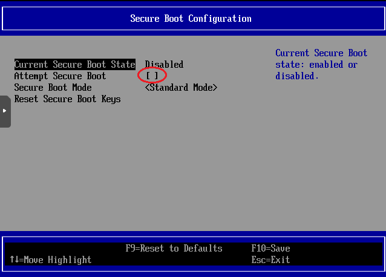

# 源自[VIKINGYFY的OpenWRT-CI](https://github.com/VIKINGYFY/OpenWRT-CI)
&emsp;&emsp;自用精简[ImmortalWrt固件](https://github.com/immortalwrt/immortalwrt)，每周六上午自动编译。

&emsp;&emsp;仅包含[AdGuard Home插件](https://github.com/AdguardTeam/AdGuardHome)、[honk插件](https://github.com/daeuniverse/openwrt-packages)以及[OpenVPN插件](https://github.com/OpenVPN/openvpn)，支持IPv6。

&emsp;&emsp;&emsp;关闭DNSMasq的DNS功能（端口设为0），AdGuard Home接管53端口，用honk分流作为其上游（DNS绑定到非53端口），可实现自定义去广告 
&emsp;&emsp;&emsp;如使用DNSMasq的DHCP功能，需要lan口加入DHCP选项下发本机为DNS服务器

### 长期支持设备：
&emsp;&emsp;**x64：** 支持虚拟机，支持[Intel X550网卡NBASE-T](https://github.com/shenlijun/openwrt-x550-nbase-t)，可自动协商被隐藏的2.5G/5G
   
&emsp;&emsp;**Cudy TR3000 256m：** 支持F50等设备
   
&emsp;&emsp;**GL-MT3600BE：** 支持F50等设备

&emsp;&emsp;#### PVE8.0以上使用EFI，需要关闭安全启动，且磁盘镜像不能放在zfs上，在zfs上不能使用EFI

&emsp;&emsp;

### 目录简要说明：

&emsp;&emsp;Scripts——自定义脚本

&emsp;&emsp;Config——自定义配置

&emsp;&emsp;workflows——自定义CI配置
